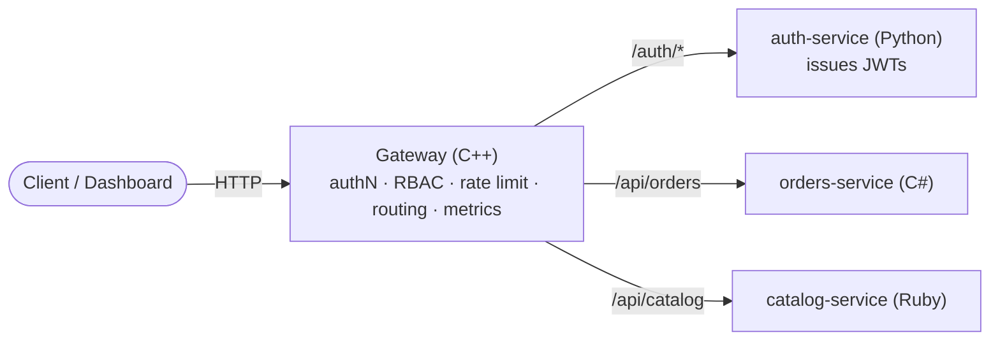

<div align="center">

```
  ▤  A P I W A Y
```

**A polyglot API gateway & authentication platform.**

One gateway for authentication, JWT validation, API keys, rate limiting, RBAC,
and routing — in front of microservices written in the language each fits best.

[](https://github.com/Anhedonicc/apiway/actions/workflows/ci.yml)
[](https://github.com/Anhedonicc/apiway/actions/workflows/codeql.yml)
[](LICENSE)
[](CONTRIBUTING.md)


</div>

---

## Why Apiway?

Most "auth" projects give you another login page. Apiway is the service
*behind* it: the piece that authenticates every request, decides what the caller
is allowed to do, throttles abuse, and routes traffic to the right microservice —
so your services don't each reinvent it.

- 🔐 **Authentication** — HS256 JWTs *and* provisioned API keys
- 🛡️ **RBAC** — per-route and per-HTTP-method permission checks
- 🚦 **Rate limiting** — token-bucket, per principal or per IP, per-route overrides
- 🧭 **Routing** — longest-prefix matching with prefix stripping and reverse proxy
- 📊 **Observability** — Prometheus metrics + Grafana dashboard out of the box
- 🖥️ **Admin dashboard** — a React console for the live routing table and a request playground
- ☸️ **Deploy anywhere** — Docker Compose, raw Kubernetes manifests, or a Helm chart

## Contents

- [Architecture](#architecture)
- [Quick start](#quick-start)
- [Try it](#try-it)
- [Configuration](#configuration)
- [RBAC](#rbac)
- [Dashboard](#dashboard)
- [Observability](#observability)
- [Deployment](#deployment)
- [Project layout](#project-layout)
- [Documentation](#documentation)
- [Contributing](#contributing)
- [License](#license)

## Architecture



| Component        | Language   | Role                                                   |
|------------------|------------|--------------------------------------------------------|
| `gateway`        | C++        | Reverse proxy enforcing authN/Z, rate limits, routing  |
| `auth-service`   | Python     | Registers users, verifies passwords, mints signed JWTs |
| `orders-service` | C#         | Example protected microservice (read/write RBAC)       |
| `catalog-service`| Ruby       | Example microservice reachable by JWT **or** API key   |
| `dashboard`      | TypeScript | React admin console for the gateway                    |

The gateway is the **trust boundary**: it authenticates the caller, checks
permissions, and forwards the resolved identity to upstreams as `X-Auth-*`
headers — after stripping any client-supplied copies, so identity can't be
forged. Full details in [docs/architecture.md](docs/architecture.md).

## Quick start

Requires Docker + Docker Compose.

```bash
cp .env.example .env         # then set a strong JWT_SECRET (./scripts/gen-secret.sh)
docker compose up --build
```

- Gateway → http://localhost:8080
- Dashboard → http://localhost:3000
- Metrics → http://localhost:8080/metrics

With the observability stack (Prometheus + Grafana):

```bash
docker compose -f docker-compose.yml -f docker-compose.observability.yml up --build
```

## Try it

```bash
# Register a user (public route) and capture the token
curl -s localhost:8080/auth/register -H 'content-type: application/json' \
  -d '{"username":"alice","password":"supersecret"}'
# -> { "access_token": "...", "roles": ["user"], "permissions": ["catalog:read","orders:read"] }

TOKEN=<paste access_token>

# Read orders (needs orders:read — the "user" role has it)         -> 200
curl -s localhost:8080/api/orders -H "Authorization: Bearer $TOKEN"

# Create an order (needs orders:write — "user" lacks it)            -> 403
curl -s -X POST localhost:8080/api/orders -H "Authorization: Bearer $TOKEN" \
  -H 'content-type: application/json' -d '{"item":"widget","quantity":2}'

# Catalog via a provisioned API key instead of a JWT               -> 200
curl -s localhost:8080/api/catalog -H 'X-API-Key: svc_catalog_reader_9f2c1a'

# No credentials                                                    -> 401
curl -s -o /dev/null -w '%{http_code}\n' localhost:8080/api/orders
```

Register with `"roles":["orders-manager"]` (or `admin`) to get write access.
Or just run the whole thing: `./scripts/smoke-test.sh`.

## Configuration

`gateway/config.yaml` is the single source of truth for routing and policy:

```yaml
routes:
  - path_prefix: /api/orders
    upstream: http://orders-service:9100
    auth: true
    required_permissions: [orders:read]
    method_permissions:
      POST: [orders:write]
    rate_limit: { rps: 10, burst: 20 }
```

Full reference: [docs/configuration.md](docs/configuration.md).

## RBAC

Roles map to permissions in the auth service; routes require permissions in the
gateway. Tokens carry the expanded permission set, so the gateway authorizes
with **zero round trips**.

| Role | Permissions |
|------|-------------|
| `admin` | `*` |
| `user` | `catalog:read`, `orders:read` |
| `orders-manager` | `orders:read`, `orders:write` |

More in [docs/rbac.md](docs/rbac.md).

## Dashboard

A React + TypeScript admin console (`dashboard/`) that signs in through the
gateway, renders the **live routing table** from the gateway's `/admin/routes`
API, and includes a **request playground** to watch authN, RBAC and rate
limiting in real time. Served on http://localhost:3000 under Compose.

## Observability

The gateway exposes Prometheus metrics at `/metrics`
(`apiway_requests_total`, `apiway_denied_total`, …). The bundled
Prometheus + Grafana stack auto-provisions a starter dashboard. See
[docs/observability.md](docs/observability.md).

## Deployment

- **Docker Compose** — `docker compose up --build`
- **Kubernetes** — `kubectl apply -f deploy/k8s/`
- **Helm** — `helm install apiway deploy/helm/apiway --set jwt.secret=...`

Guide: [docs/deployment.md](docs/deployment.md).

## Project layout

```
apiway/
├── gateway/                 # C++ gateway (CMake) — the platform
│   ├── include/             # crypto, jwt, config, rbac, rate limit, metrics
│   ├── src/                 # main, jwt, config
│   └── tests/               # unit tests (ctest)
├── services/
│   ├── auth-service/        # Python (FastAPI) — issues JWTs
│   ├── orders-service/      # C# (ASP.NET minimal API)
│   └── catalog-service/     # Ruby (Sinatra)
├── dashboard/               # React + TypeScript admin console
├── deploy/
│   ├── k8s/                 # raw manifests
│   └── helm/apiway/      # Helm chart
├── monitoring/              # Prometheus + Grafana provisioning
├── docs/                    # architecture, config, RBAC, deployment, API spec
├── scripts/                 # smoke test, secret gen, k6 load test
└── docker-compose*.yml
```

## Documentation

| Doc | What |
|-----|------|
| [Architecture](docs/architecture.md) | Request lifecycle and trust model |
| [Getting started](docs/getting-started.md) | Run the stack or a single service |
| [Configuration](docs/configuration.md) | Every config field explained |
| [RBAC](docs/rbac.md) | Roles, permissions, and route policy |
| [Observability](docs/observability.md) | Metrics and Grafana |
| [Deployment](docs/deployment.md) | Compose, Kubernetes, Helm |
| [API (OpenAPI)](docs/api/openapi.yaml) | Auth + gateway admin surface |
| [Roadmap](docs/roadmap.md) | Where this is going |

## Contributing

Contributions are welcome in any of the stack's languages — see
[CONTRIBUTING.md](CONTRIBUTING.md) and our [Code of Conduct](CODE_OF_CONDUCT.md).
Run `make test` before opening a PR.

## License

[MIT](LICENSE) © The Apiway Authors
