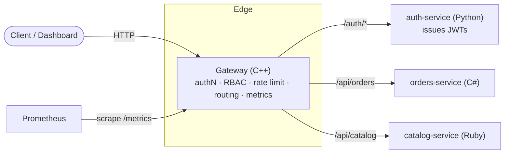

# Architecture

Apiway is a polyglot platform: a single gateway enforces cross-cutting
concerns in front of independent microservices written in different languages.

## Request lifecycle

1. **Route match** — longest path-prefix wins.
2. **Authenticate** — for protected routes, verify a bearer JWT (HS256) or an
   API key. Failure → `401`.
3. **Authorize (RBAC)** — check the token's permissions against the route's
   `required_permissions`, with optional per-HTTP-method overrides. Failure →
   `403`.
4. **Rate limit** — token bucket keyed by principal (or source IP for public
   routes). Exhaustion → `429`.
5. **Proxy** — strip any client-supplied `X-Auth-*` headers, stamp the resolved
   identity, and forward to the upstream. Record metrics.

## Trust boundary

The gateway is the trust boundary. Downstream services never parse tokens; they
trust the `X-Auth-*` headers the gateway sets and must not be exposed directly
to clients. The gateway always deletes inbound copies of those headers before
setting its own, so a client cannot forge an identity.

## Why polyglot?

Each concern lives where it is cheapest to express:

| Concern | Home | Rationale |
|---------|------|-----------|
| Hot-path proxying, crypto | C++ gateway | Predictable latency, no GC pauses |
| Identity & token issuance | Python auth-service | Fast iteration, rich ecosystem |
| Business logic | C# / Ruby services | Team/domain choice, drop-in more |
| Operator UX | TypeScript dashboard | Standard web tooling |

Adding a service is additive: register a route in `gateway/config.yaml` pointing
at the new upstream — no gateway code changes.
